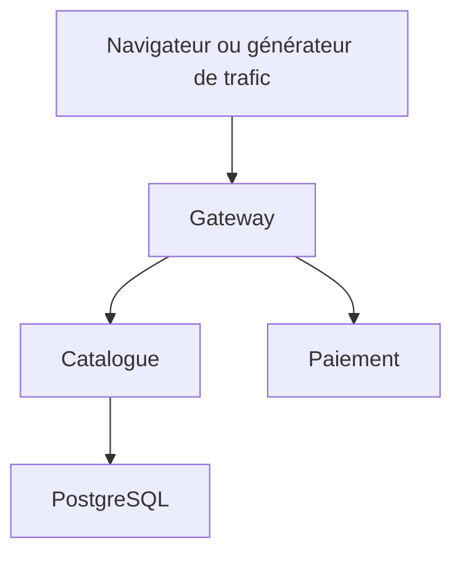

# ParcelFlow et Coroot

Une application de commande traverse une gateway, un catalogue PostgreSQL et un service de paiement simulé. Quatre incidents permettent de chercher la cause d'une dégradation dans Coroot, de mesurer l'impact côté client puis de vérifier la correction.

Le projet fournit un lanceur macOS et un lanceur PowerShell Windows. Chaque lanceur crée une VM Ubuntu 24.04 dédiée et y installe Kubernetes K3s directement dans Linux. Les interfaces s'ouvrent dans le navigateur de l'hôte.

## Préparer le poste

- macOS 14 ou ultérieur, Mac Intel ou Apple Silicon, ou Windows 10/11 x64 avec virtualisation matérielle activée.
- Installer la version actuelle de Multipass avec l'installeur officiel. Rouvrir le terminal et vérifier `multipass version`.
- Sur Windows, activer « Plateforme de machine virtuelle » si l'installeur le demande, puis redémarrer. Utiliser le pilote proposé par la version actuelle de Multipass. Les anciennes versions utilisant Hyper-V ont d'autres contraintes d'édition Windows.
- Prévoir 16 Go de RAM au minimum sur l'hôte, 45 Go de disque disponibles et une connexion Internet. La VM reçoit 6 CPU virtuels et 10 Go de RAM. Fermer les autres environnements lourds si nécessaire. Avec 24 ou 32 Go de RAM, la marge est plus confortable.
- Extraire complètement l'archive dans un dossier local. Sur Windows, éviter l'exécution depuis le dossier ZIP et les dossiers synchronisés pendant la préparation.

Docker, Node.js, Helm et kubectl sont installés ou utilisés dans la VM. Le moteur Kubernetes est containerd. Docker y sert à construire l'image de démonstration.

Installation officielle de Multipass et prérequis par système — https://canonical.com/multipass/docs/stable/how-to-guides/install-multipass/

## Démarrer sur macOS

Ouvrir le terminal à la racine du projet, puis exécuter les commandes suivantes.

```bash
multipass version
bash demo.sh up
```

## Démarrer sur Windows

Ouvrir PowerShell à la racine du projet, puis exécuter les commandes suivantes. L'option de stratégie d'exécution s'applique à ce processus PowerShell.

```powershell
multipass version
powershell.exe -NoProfile -ExecutionPolicy Bypass -File .\demo.ps1 up
```

Si votre organisation impose une stratégie d'exécution, utiliser la procédure qu'elle autorise pour les scripts locaux. L'installation système de Multipass demande des droits administrateur. Le lancement habituel se fait depuis un terminal utilisateur.

## Ouvrir les interfaces

À la fin de `up`, le lanceur affiche les adresses réelles de la VM, le compte Coroot `admin` et son mot de passe aléatoire. Ouvrir l'application sur le port 30081 et Coroot sur le port 30080. Conserver le mot de passe dans le contexte de cette démonstration. La commande `urls` permet de le retrouver.

La VM s'appelle `coroot-demo`. Un marqueur empêche de réutiliser silencieusement une VM du même nom qui ne proviendrait pas de ce projet. Une nouvelle exécution de `up` remet les manifestes et les incidents dans leur état de départ, avec conservation des volumes existants.

## Faire la démonstration

Lire [docs/DEMONSTRATION.md](docs/DEMONSTRATION.md). Commencer par le trafic nominal et valider la collecte Coroot avant de provoquer une panne.

| Action | macOS | Windows PowerShell |
| --- | --- | --- |
| Démarrer le trafic | `bash demo.sh traffic` | `powershell.exe -NoProfile -ExecutionPolicy Bypass -File .\demo.ps1 traffic` |
| SQL lent | `bash demo.sh sql` | `powershell.exe -NoProfile -ExecutionPolicy Bypass -File .\demo.ps1 sql` |
| CPU élevé | `bash demo.sh cpu` | `powershell.exe -NoProfile -ExecutionPolicy Bypass -File .\demo.ps1 cpu` |
| Paiement arrêté | `bash demo.sh outage` | `powershell.exe -NoProfile -ExecutionPolicy Bypass -File .\demo.ps1 outage` |
| Version défectueuse | `bash demo.sh regression` | `powershell.exe -NoProfile -ExecutionPolicy Bypass -File .\demo.ps1 regression` |
| Retour nominal | `bash demo.sh reset` | `powershell.exe -NoProfile -ExecutionPolicy Bypass -File .\demo.ps1 reset` |
| Contrôler le parcours client | `bash demo.sh verify` | `powershell.exe -NoProfile -ExecutionPolicy Bypass -File .\demo.ps1 verify` |
| État des composants | `bash demo.sh status` | `powershell.exe -NoProfile -ExecutionPolicy Bypass -File .\demo.ps1 status` |
| Derniers logs applicatifs | `bash demo.sh logs` | `powershell.exe -NoProfile -ExecutionPolicy Bypass -File .\demo.ps1 logs` |
| Adresses et accès Coroot | `bash demo.sh urls` | `powershell.exe -NoProfile -ExecutionPolicy Bypass -File .\demo.ps1 urls` |
| Suspendre le trafic | `bash demo.sh pause` | `powershell.exe -NoProfile -ExecutionPolicy Bypass -File .\demo.ps1 pause` |
| Arrêter la VM | `bash demo.sh stop` | `powershell.exe -NoProfile -ExecutionPolicy Bypass -File .\demo.ps1 stop` |
| Redémarrer la VM | `bash demo.sh start` | `powershell.exe -NoProfile -ExecutionPolicy Bypass -File .\demo.ps1 start` |

Si la stratégie PowerShell le nécessite, conserver `-NoProfile -ExecutionPolicy Bypass` avant `-File` comme au premier lancement.

## Architecture



Coroot collecte la télémétrie des conteneurs via un agent sur le nœud et des composants Kubernetes dédiés. L'installation utilise les charts officiels embarqués et vérifiés par SHA-256. ClickHouse et Prometheus utilisent chacun une instance. ClickHouse Keeper utilise trois instances de coordination sur le même nœud de la VM.

Les trois services utilisent HTTP clair dans le réseau privé de démonstration. Cela facilite l'observation des échanges par eBPF. Les flags Node.js nécessaires à la symbolisation du profil CPU sont présents, et un volume temporaire permet l'écriture des fichiers perf.

Le fichier `docs/DEMONSTRATION.md` explique les mesures attendues et celles qui nécessitent une configuration complémentaire.

## Versions et validation

K3s `v1.35.8+k3s1`, Helm `3.19.0`, chart opérateur Coroot `0.10.6`, chart Community Edition `0.3.3`, Node.js 24 et PostgreSQL 17. Les images applicative de base et PostgreSQL sont verrouillées par empreinte. Les images Coroot sont verrouillées par empreinte dans `coroot/values.yaml`. Voir [docs/VALIDATION.md](docs/VALIDATION.md) pour le statut exact des contrôles.

Le dossier `.local/` est ignoré par Git. Il conserve les repères horaires des incidents dans la VM. Les produits sont des données de démonstration. Les reçus de commande et de paiement sont simulés et ne sont pas persistés.

## Arrêter et supprimer

`stop` conserve la VM et les données. Pour supprimer définitivement la VM de ce projet, utiliser explicitement les commandes Multipass suivantes après avoir conservé les observations utiles.

```bash
multipass delete --purge coroot-demo
```

## Organisation

- `app/` contient les services, le portail Comfortaa et le générateur de trafic.
- `k8s/` contient les ressources déclaratives de ParcelFlow.
- `coroot/` contient les réglages et les charts officiels redistribués.
- `scripts/` contient la préparation Linux et le contrôle des scénarios.
- `demo.sh` et `demo.ps1` pilotent la VM depuis l'hôte.
- `tests/` et le workflow GitHub Actions contrôlent les parcours HTTP et PostgreSQL.

Les sources officielles et les licences des éléments redistribués figurent dans `docs/SOURCES.md`.
